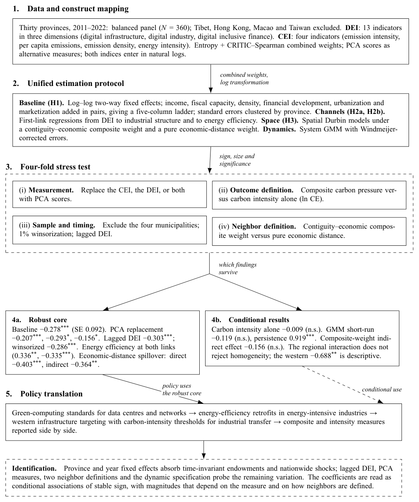

# Digital Economy and Carbon Emissions in China

**An Empirical Analysis of the Impact of the Digital Economy on Carbon Emissions: Evidence from China's Provincial Panel Data**

Mingyu Fan, Yile Wang (corresponding author)  
School of Economics, Beijing Technology and Business University, Beijing 102488, China

This repository is the replication package and archival copy of the manuscript: the processed provincial panel, the spatial weight matrices, the estimation code, the LaTeX source, and the compiled PDF. It corresponds to the Data Availability Statement in the paper.

## Overview

The paper examines whether digital economy development is associated with lower carbon emission pressure in China, and whether the answer depends on measurement, functional form, mechanism, and the definition of "neighbor". The sample is a balanced panel of 30 provincial-level regions from 2011 to 2022 (N = 360). The digital economy index (DEI) combines 13 indicators in three dimensions; the carbon emission pressure index (CEI) combines four indicators. Both are built with entropy and CRITIC–Spearman weights, with PCA scores as alternative measures. The analysis uses log–log two-way fixed-effects models, spatial Durbin models under two neighbor definitions, and system GMM.



## Key results

- Baseline elasticity: **−0.278** (SE 0.092, p < 0.01). A 10% increase in DEI is associated with about a 2.8% decrease in CEI.
- The association survives PCA replacement (−0.207, −0.293, −0.156), lagged DEI (−0.303), exclusion of the four municipalities (−0.276), and 1% winsorization (−0.286).
- Carbon intensity alone is not significantly associated with DEI (−0.009, n.s.): the result is about the composite pressure index, not carbon intensity as a single indicator.
- Energy efficiency is the stronger channel (first link 0.336; second link −0.335). Industrial structure upgrading operates at the first link (0.247).
- Spatial spillovers are negative and significant under pure economic-distance weights (direct −0.403, indirect −0.364), but not under administrative contiguity.
- Carbon pressure is highly persistent (0.919).

## Repository structure

```text
.
├── data/                 processed panel, spatial weights, Moran output
├── code/
│   ├── python/           table replication in pandas + linearmodels
│   └── stata/            original Stata do-files, archived and path-adapted
├── manuscript/           LaTeX source, MDPI class, figures, compiled PDF
└── figures/              figure previews used in this README
```

## Data

The processed panel is `data/panel_AI5.csv` (30 provinces × 12 years, N = 360). Variables:

| Variable | Definition |
|---|---|
| `sh` | Province (short name, Chinese) |
| `年份` (`year`) | Year, 2011–2022 |
| `DEI` | Digital economy index, combined weights |
| `CEI` | Carbon emission pressure index, combined weights |
| `CE` | Carbon emission intensity |
| `lnCE`, `lnDEI`, `lnCEI` | Natural logs |
| `lnpgdp` | Log per capita GDP |
| `fisc` | Fiscal expenditure / GDP |
| `dens` | Population density (people/km²) |
| `fin` | (Deposits + loans) / GDP |
| `urb` | Urbanization rate |
| `mkt` | Marketization index |
| `inds` | Industrial structure upgrading (tertiary/secondary) |
| `ee` | Energy efficiency (output per unit of energy) |

Other files:

- `panel_with_pca.csv`: panel with PCA-based DEI/CEI measures (robustness).
- `W_economic_distance.csv`, `W_geographic_contiguity.csv`: row-standardized 30×30 weight matrices used in the paper.
- `Wadj.txt`, `Wadj_bin.txt`, `Wdist.txt`, `Wecon.txt`, `FWadj.dta`, `FWdist.dta`, `FWecon.dta`, `panel.txt`: Stata inputs for the spatial and Moran do-files.
- `local_moran.txt`, `moran_width.txt`: local/global Moran output.
- `lisa_quadrants.csv`: province-year LISA quadrant assignments used in Figure 5.

Data sources: China Statistical Yearbook, China Energy Statistical Yearbook, China Internet Network Information Center, Ministry of Industry and Information Technology, China Industrial Statistical Yearbook, and the Peking University Digital Financial Inclusion Index. Carbon emissions follow the IPCC sectoral approach and are consistent with the CEADs accounting framework. Raw yearbook files are not redistributed; the panel here is the processed version used in the paper.

## Code

### Tables in Python

```bash
pip install pandas numpy linearmodels
python code/python/replicate_tables.py
```

This reproduces the baseline and robustness estimates (baseline, carbon intensity, industrial-structure variants, lagged DEI, exclusion of municipalities, winsorization, descriptive statistics).

### Tables in Stata

`code/stata/` contains the archived do-files. Set Stata's working directory to the repository's `data/` folder (or edit the `cd` line at the top), then run:

| File | Purpose |
|---|---|
| `01_baseline_panel_fe.do` | Baseline two-way fixed-effects estimates (Table 4) |
| `02_mechanism_energy_efficiency.do` | Energy-efficiency channel (Table 7) |
| `03_spatial_sdm_sar_sem.do` | Spatial Durbin/SAR/SEM under economic distance |
| `04_composite_weight_sdm.do` | Spatial models under the composite weight |
| `05_system_gmm.do` | System GMM (Table 12) |
| `06_global_moran.do` | Global Moran's I and Geary's c |

Stata 17 or later is required; the spatial models use `xsmle` and `spatwmat`.

### Manuscript

```bash
cd manuscript
pdflatex main.tex
pdflatex main.tex
```

The compiled `main.pdf` is included. The template is the MDPI 2026 LaTeX class with APA references; keep the `Definitions/` folder next to `main.tex`.

## Citation

If you use the data or code, please cite the paper:

> Fan, M., & Wang, Y. (2026). *An empirical analysis of the impact of the digital economy on carbon emissions: Evidence from China's provincial panel data* [Manuscript submitted for publication]. School of Economics, Beijing Technology and Business University.

```bibtex
@unpublished{fan2026digital,
  author = {Fan, Mingyu and Wang, Yile},
  title  = {An Empirical Analysis of the Impact of the Digital Economy on Carbon Emissions: Evidence from China's Provincial Panel Data},
  year   = {2026},
  note   = {Manuscript submitted for publication},
  url    = {https://github.com/KarlHeinrich-jpg/digital-economy-carbon-emissions-china}
}
```

## License

- Code: MIT License (see `LICENSE`).
- Processed data and manuscript: Creative Commons Attribution 4.0 International (CC BY 4.0).

## Contact

Mingyu Fan, 2401050107@st.btbu.edu.cn  
Yile Wang, 2401050128@st.btbu.edu.cn
